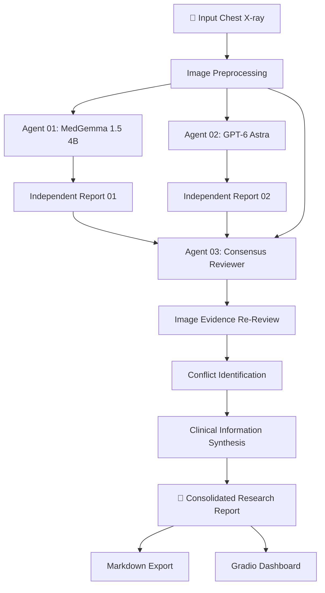
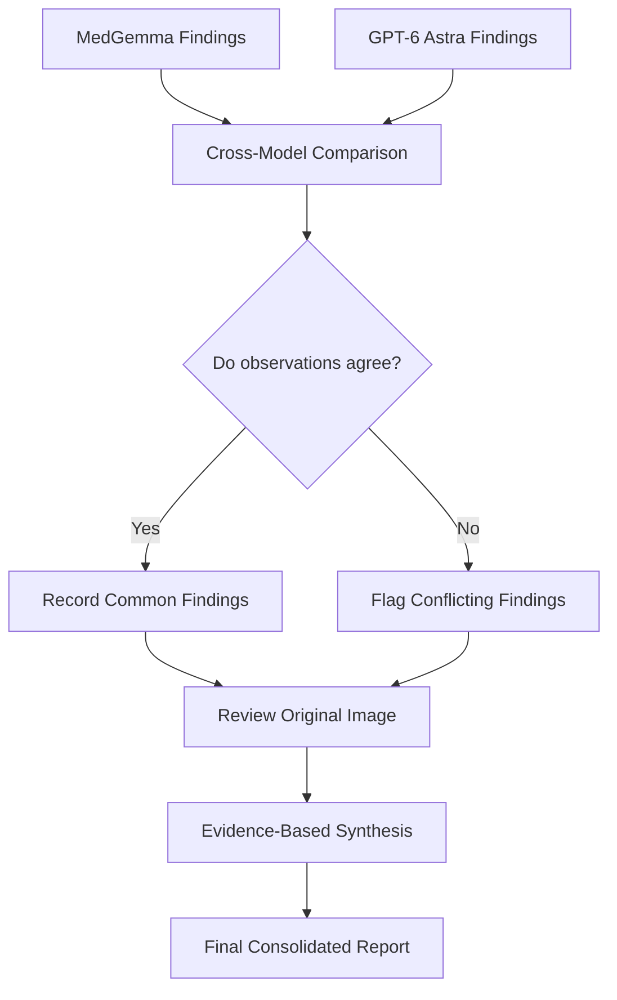

# 🩻 Multi-Model Chest X-Ray Analysis & Consensus System

<p align="center">
  
  
  
  
  
</p>

<p align="center">
  <b>An AI-powered multi-model framework for independent Chest X-ray analysis, cross-model verification, and consensus-based report generation.</b>
</p>

---

## 🧬 Overview

Medical image interpretation is a complex task where accuracy, consistency, and evidence-based reasoning are essential.

This project explores a **Multi-Model AI Consensus Framework** that combines a locally deployed medical vision-language model with cloud-based AI analysis to generate a consolidated Chest X-ray research report.

Instead of relying on a single model, the system obtains two independent interpretations and passes them to a third AI agent for evidence-based comparison and review.

### The Three-Agent Approach

| Agent | Model | Responsibility |
|:---:|---|---|
| 🧠 Agent 01 | Google MedGemma 1.5 4B IT | Independent medical image analysis |
| 🔬 Agent 02 | OpenAI GPT-6 Astra | Independent visual interpretation |
| ⚖️ Agent 03 | GPT-6 Astra Reviewer | Cross-verification and consensus generation |

The final output includes individual model reports, identified disagreements, and a consolidated analysis.

---

## 🏗️ System Architecture

The framework follows a parallel-analysis and centralized-review architecture.



### 🔄 Analysis Workflow

1. **Image Input:** Upload a Chest X-ray through the Gradio interface.
2. **Parallel Analysis:** The original image is independently analyzed by MedGemma and GPT-6 Astra.
3. **Draft Generation:** Each model produces its own interpretation.
4. **Consensus Review:** A third GPT-6 Astra agent receives the original image and both independent reports.
5. **Evidence Verification:** The reviewer examines agreements, disagreements, and potentially unsupported observations.
6. **Final Report:** A consolidated report is generated and made available for viewing and download.

---

## ✨ Key Features

### 🧠 1. Hybrid Multi-Model Intelligence

**Google MedGemma 1.5 4B IT — Local Analysis**

- Runs locally on a Google Colab GPU.
- Supports 4-bit quantization to reduce GPU memory requirements.
- Uses FP32 computation settings where configured to improve numerical stability.
- Produces an independent Chest X-ray interpretation.

**OpenAI GPT-6 Astra — Cloud Analysis**

- Analyzes the original Chest X-ray independently.
- Generates a second interpretation for comparison.
- Provides a separate perspective before consensus review.

**GPT-6 Astra — Consensus Reviewer**

- Receives both independent reports.
- Re-examines the original image.
- Identifies similarities and conflicting observations.
- Produces a consolidated research-oriented report.

### ⚡ 2. Intelligent Double-Layer Caching

The system implements two caching mechanisms to reduce repeated model-loading overhead.

| Caching Layer | Function |
|---|---|
| ⚡ In-Memory Cache | Retains the loaded model during an active runtime session |
| 💾 Persistent Cache | Stores reusable model artifacts in Google Drive for subsequent sessions |

This reduces unnecessary model initialization and quantization operations.

### 🌐 3. Interactive Gradio Dashboard

The application provides a unified interface for managing the complete analysis workflow.

- Upload Chest X-ray images.
- Track individual model execution.
- Monitor pipeline progress through status indicators.
- View generated analysis reports.
- Download individual model outputs.
- Download the final consolidated report.

### 📑 4. Structured Report Generation

Every execution produces a timestamp-based report directory containing the complete analysis package.

---

## 📊 Model Comparison & Consensus Process

The third agent is not simply asked to combine two responses. It is instructed to examine the reports against the original image and distinguish between agreement and disagreement.



**Important:** Consensus does not automatically imply correctness. A disagreement between models should remain explicitly documented when the available image evidence cannot resolve it.

---

## 🛠️ Technology Stack

| Category | Technologies |
|---|---|
| Programming Language | Python 3.10+ |
| Medical Vision Model | Google MedGemma 1.5 4B IT |
| Cloud AI | OpenAI GPT-6 Astra |
| Model Framework | Hugging Face Transformers |
| Quantization | BitsAndBytes |
| API Integration | OpenAI Python SDK |
| User Interface | Gradio |
| Image Processing | Pillow |
| Execution Environment | Google Colab |
| Model Storage | Google Drive |

---

## 🚀 Installation & Setup

### 1. Prerequisites

- Google account with access to Google Colab.
- Hugging Face account.
- Access to the MedGemma model and acceptance of its license.
- OpenAI API key.
- GPU-enabled Colab runtime.

**Recommended GPU configurations:**

| GPU | Usage |
|---|---|
| NVIDIA T4 | Quantized local model execution |
| NVIDIA L4 | Higher-performance execution |
| NVIDIA A100 | More GPU memory and computational headroom |

Actual memory requirements depend on model configuration, image resolution, and runtime settings.

### 2. Install Dependencies

Execute the following command in a Colab cell:

```bash
pip install -q -U "transformers>=4.50.0" accelerate bitsandbytes openai pillow "gradio>=5"
```

### 3. Configure API Credentials

Open the **Secrets** section in Google Colab and configure the following:

| Secret Name | Description |
|---|---|
| `OpenAI` | OpenAI API key |
| `HF_TOKEN` | Hugging Face access token (if required) |

Ensure that the Hugging Face account has accepted the MedGemma model license.

### 4. Launch the Application

Execute the main application cell:

```python
demo.launch(share=True)
```

Gradio will generate a temporary public URL that can be accessed through a web browser.

---

## 📁 Generated Report Structure

All analysis executions are saved in timestamp-based directories.

```text
/content/
│
└── Xray_Analysis_Reports/
    │
    └── [Timestamp_Folder]/
        │
        ├── 00_Full_Analysis.md
        │
        ├── 01_MedGemma_Report.md
        │
        ├── 02_GPT6_Astra_Report.md
        │
        └── 03_Final_Verified_Report.md
```

### 📄 Report Description

| File | Description |
|---|---|
| `00_Full_Analysis.md` | Complete analysis package |
| `01_MedGemma_Report.md` | Independent MedGemma interpretation |
| `02_GPT6_Astra_Report.md` | Independent GPT-6 Astra interpretation |
| `03_Final_Verified_Report.md` | Consensus review and consolidated findings |

---

## 🔬 Research Objectives

This project explores several important questions in multi-model AI systems:

- Can independent AI interpretations provide a useful basis for cross-model verification?
- Can a third model identify disagreements between two independently generated reports?
- Does reviewing the original image alongside generated reports improve the quality of the synthesis process?
- How can local and cloud-based vision-language models be combined efficiently?
- Can caching mechanisms make repeated multimodal model execution more practical?

The system serves as an experimental framework for exploring multi-agent collaboration in medical image analysis.

---

## ⚠️ Medical Disclaimer

> **IMPORTANT — RESEARCH AND EDUCATIONAL USE ONLY**
>
> This project is intended exclusively for AI research, experimentation, and educational validation.
>
> It is not a certified medical diagnostic system, has not been clinically validated, and is not intended for use in clinical decision-making or patient management.
>
> AI-generated interpretations may contain incorrect findings, omissions, or hallucinations. Agreement between multiple AI models does not establish diagnostic accuracy.
>
> All outputs must be independently evaluated by qualified medical professionals. Never use this system as a substitute for professional radiological interpretation.

---

## 👨‍💻 Project Philosophy

**One image. Two independent perspectives. One evidence-based review.**

The objective is to explore how multiple specialized AI models can collaborate, challenge each other's interpretations, and produce more transparent and structured outputs.

Rather than assuming that one model is always correct, this project experiments with a workflow where independent analysis, disagreement identification, and evidence-based review are central to the process.

---

<p align="center">
  <b>Built for experimentation in Multi-Model AI & Medical Vision-Language Systems.</b>
  <br/>
  <sub>AI Research • Multimodal Intelligence • Model Consensus</sub>
</p>
